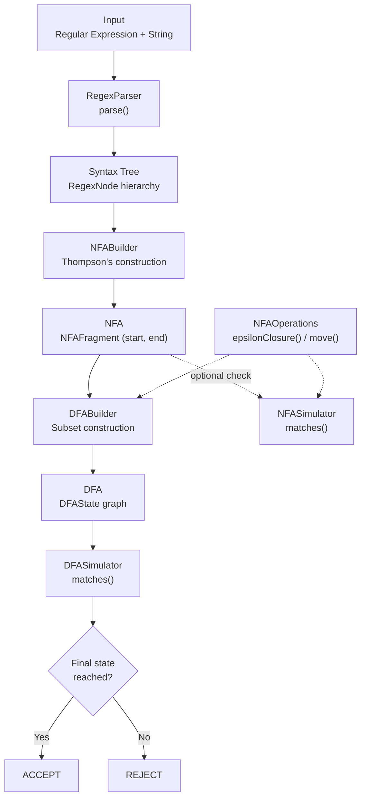
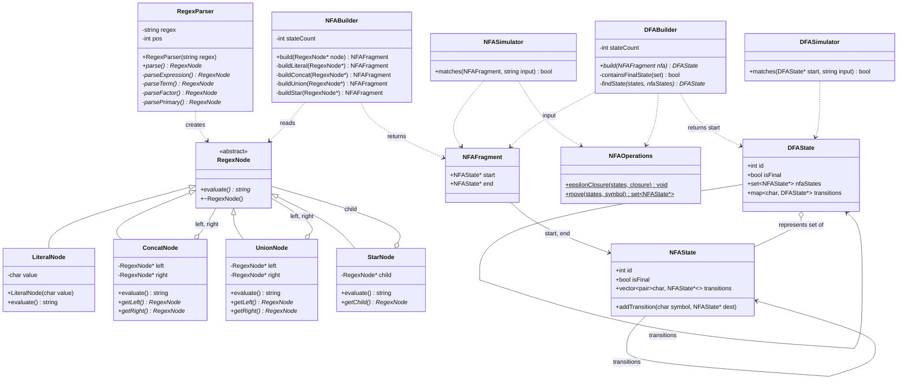
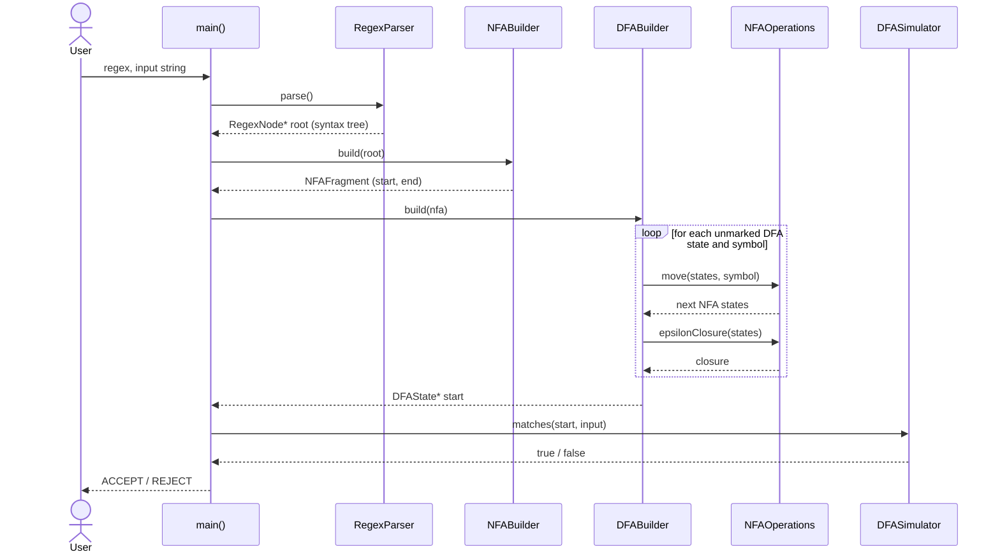
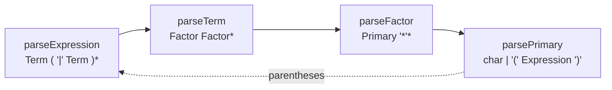
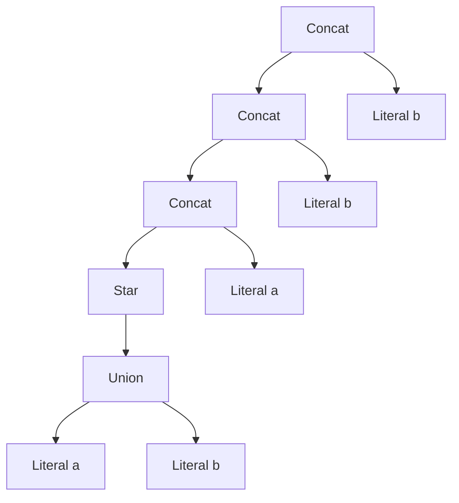
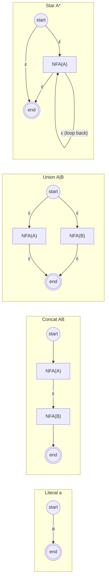
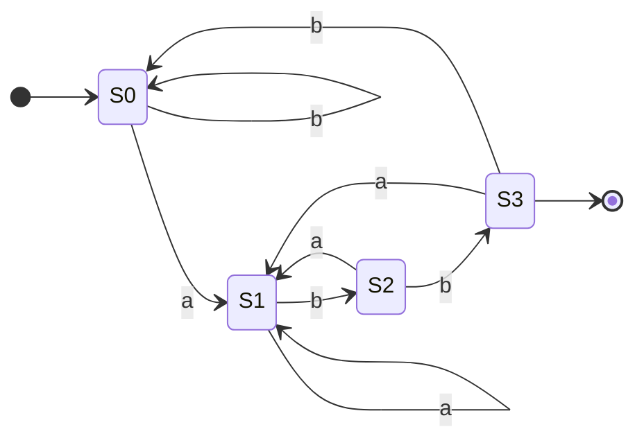

# Diagrams

All diagrams are written in [Mermaid](https://mermaid.js.org/), which GitHub renders automatically.

## 1. Architecture Diagram

End-to-end pipeline, showing which component handles each stage (see `src/main.cpp`).

> `NFASimulator` is available for testing the NFA directly, but `main.cpp` runs the DFA path.

## 2. Class Diagram

## 3. Sequence Diagram (Program Flow)

## 4. Parser Grammar

Operator precedence, lowest to highest: union, concatenation, star. Each rule matches a `RegexParser` method.

## 5. Example Syntax Tree for `(a|b)*abb`

## 6. Thompson's Construction Patterns

`ε` marks an epsilon transition (stored as `'\0'` internally).

## 7. DFA for `(a|b)*abb`

The minimal equivalent DFA. The program's subset construction gives an equivalent automaton, possibly with extra states.

